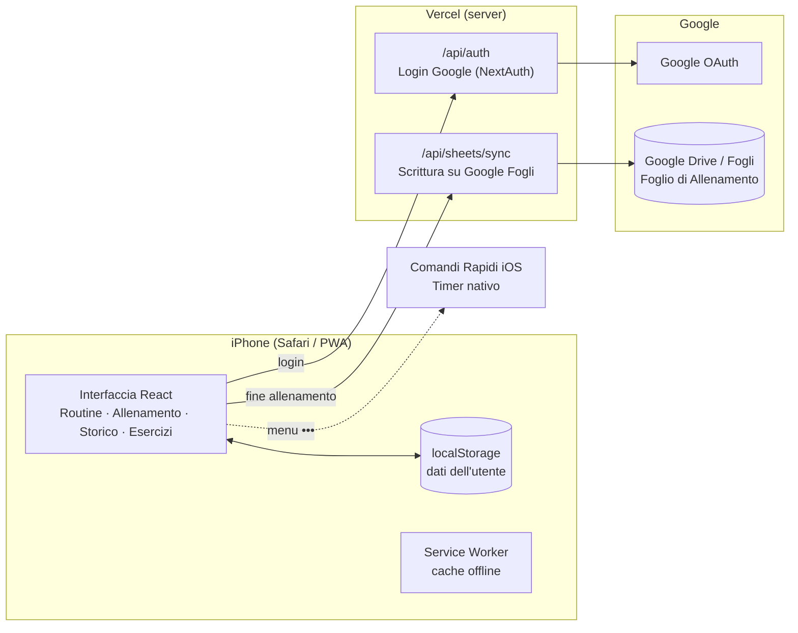

# StrongVMAX

**Tracker di allenamenti in palestra pensato per iPhone, installabile come app dalla schermata Home (PWA).**
Interfaccia in italiano, ispirata all'app *Strong*, con integrazione diretta con le schede di allenamento su Google Fogli.

🔗 **App:** https://strong-vmax.vercel.app


---

## Indice

- [Funzionalità](#funzionalità)
- [Dove vengono salvati i dati](#dove-vengono-salvati-i-dati)
- [Architettura](#architettura)
- [Struttura del progetto](#struttura-del-progetto)
- [Avvio in locale](#avvio-in-locale)
- [Variabili d'ambiente](#variabili-dambiente)
- [Deploy su Vercel](#deploy-su-vercel)
- [Installazione su iPhone](#installazione-su-iphone)
- [Integrazione con Google Fogli](#integrazione-con-google-fogli)
- [Timer nativo iPhone](#timer-nativo-iphone)
- [Limiti noti e roadmap](#limiti-noti-e-roadmap)

---

## Funzionalità

L'app ha tre schede principali, navigabili con la tab bar in basso o con uno swipe orizzontale.

### 🏋️ Routine
- Creazione e modifica di **template di allenamento** (routine).
- Organizzazione in **cartelle e sottocartelle** (es. `Programma → S1, S2, … S6`).
- Per ogni esercizio della routine: numero di serie, **ripetizioni target**, **RPE target** e **tempo di recupero personalizzato**.
- Riordino degli esercizi tramite drag & drop.
- Avvio rapido di un **Workout libero** senza template.

### ⏱️ Allenamento attivo
- Schermata a tutto schermo, **minimizzabile** con un gesto verso il basso (resta una barra flottante).
- Timer dell'allenamento sempre attivo, anche cambiando scheda.
- Tabella serie con **kg**, **reps** (o durata), **RPE** e spunta ✓; colonna con i valori della sessione precedente.
- Tipi di serie: **Normale**, **W** (riscaldamento, esclusa dal volume), **D** (dropset), **F** (cedimento).
- **Timer di recupero** automatico alla spunta, regolabile al volo (+/−), con barra di avanzamento.
- Tastierino numerico personalizzato con stepper, eliminazione serie con swipe.
- Riordino ed eliminazione degli esercizi, aggiunta dal catalogo o creazione al volo.
- Campo **Sensazioni / Feedback** per ogni esercizio.
- Selettore rapido della **settimana** (`S1…S6`) per il collegamento con la scheda su Google Fogli.
- Menu `•••` con scorciatoie a **Spotify**, **Google Fogli** e **Timer iPhone**.
- Al termine: riepilogo (durata + volume) e sincronizzazione automatica con Google Fogli (se collegato).

### 📊 Storico
- Elenco delle sessioni con data, durata, volume ed esercizi.
- Riepilogo settimanale e **calendario mensile** degli allenamenti (navigabile con swipe).
- Modifica di una sessione passata e **ri-sincronizzazione** con Google Fogli.
- Storico per singolo esercizio.
- Profilo: collegamento account Google, tema chiaro/scuro, **backup e ripristino dei dati** (export/import JSON).

### 📚 Esercizi
- Catalogo personale degli esercizi, filtrabile per **gruppo muscolare** e **attrezzatura**.
- Supporto a diversi tipi di bilanciere (olimpico 20 kg, EZ, personalizzato, …).

### Calcolo del volume

```
volume_serie    = kg × reps          (le serie di riscaldamento "W" valgono 0)
volume_sessione = somma dei volumi delle serie completate
```

---

## Dove vengono salvati i dati

> [!WARNING]
> **Tutti i dati (routine, cartelle, esercizi, storico) sono salvati solo sul dispositivo**, nel `localStorage` del browser. Non esiste (ancora) un database online.

Conseguenze pratiche su iPhone:

- I dati dell'icona sulla schermata Home sono **separati** da quelli di Safari, anche se l'indirizzo è lo stesso.
- **Eliminare l'icona dalla schermata Home cancella anche i dati.**
- Cambiare indirizzo dell'app (es. un nuovo dominio Vercel) significa partire con una memoria vuota.

👉 Usa regolarmente **Storico → Profilo → Backup & Trasferimento Dati → Esporta** per salvare una copia JSON dei tuoi dati, che potrai reimportare con **Importa**.

Le chiavi usate nel `localStorage` sono: `vmax_exercises`, `vmax_templates`, `vmax_folders`, `vmax_history`, `vmax_rest_<idEsercizio>`.

---

## Architettura



- **Frontend:** tutta l'interfaccia gira nel browser dell'iPhone (React + Next.js, componenti client).
- **Backend:** solo due endpoint serverless su Vercel — il login Google e la sincronizzazione con Google Fogli.
- **Offline:** il service worker generato da `next-pwa` mantiene l'app utilizzabile anche senza connessione.

### Stack

| Livello | Tecnologia |
|---|---|
| Framework | [Next.js 14](https://nextjs.org) (App Router) |
| Linguaggio | TypeScript |
| UI | React 18, Tailwind CSS, icone [lucide-react](https://lucide.dev) |
| Autenticazione | [NextAuth](https://next-auth.js.org) con provider Google |
| Dati | `localStorage` del dispositivo |
| PWA | [next-pwa](https://github.com/shadowwalker/next-pwa) (manifest + service worker) |
| Integrazioni | Google Drive API, Google Sheets API, Comandi Rapidi iOS |
| Hosting | [Vercel](https://vercel.com), deploy automatico ad ogni push su `main` |

---

## Struttura del progetto

```
StrongVMAX/
├── README.md
└── webapp/                         ← applicazione Next.js (Root Directory su Vercel)
    ├── public/
    │   ├── manifest.json           ← configurazione PWA (nome, icone, colori)
    │   └── StrongVMAX Timer.shortcut  ← Comando Rapido iOS per il timer nativo
    └── src/
        ├── app/
        │   ├── layout.tsx          ← struttura comune a tutte le pagine
        │   ├── page.tsx            ← scheda Routine
        │   ├── history/page.tsx    ← scheda Storico
        │   ├── exercises/page.tsx  ← scheda Esercizi
        │   ├── login/page.tsx      ← accesso con Google / ospite
        │   └── api/
        │       ├── auth/[...nextauth]/route.ts  ← login Google
        │       └── sheets/sync/route.ts         ← sincronizzazione Google Fogli
        ├── components/
        │   ├── MainTabSwiper.tsx   ← navigazione a swipe tra le tre schede
        │   ├── BottomTabBar.tsx    ← tab bar in basso
        │   ├── views/              ← RoutineView, HistoryView, ExercisesView
        │   └── workout/ActiveWorkout.tsx  ← schermata di allenamento attivo
        ├── context/
        │   ├── WorkoutContext.tsx  ← stato globale dell'allenamento in corso
        │   └── ThemeContext.tsx    ← tema chiaro/scuro
        ├── lib/auth.ts             ← configurazione NextAuth (Google + refresh token)
        └── utils/storage.ts        ← lettura/scrittura dei dati nel localStorage
```

---

## Avvio in locale

Requisiti: **Node.js 18+** e npm.

```bash
cd webapp
npm install
cp .env.example .env.local   # poi compila i valori (vedi sotto)
npm run dev
```

L'app sarà disponibile su http://localhost:3000.

| Comando | Descrizione |
|---|---|
| `npm run dev` | Server di sviluppo con ricarica automatica |
| `npm run build` | Build di produzione (genera anche il service worker) |
| `npm run start` | Avvia la build di produzione |
| `npm run lint` | Controllo statico del codice |

---

## Variabili d'ambiente

Da impostare in `webapp/.env.local` (in locale) e in **Vercel → Settings → Environment Variables** (in produzione).

| Variabile | Descrizione |
|---|---|
| `GOOGLE_CLIENT_ID` | Client ID OAuth creato su Google Cloud Console |
| `GOOGLE_CLIENT_SECRET` | Client Secret OAuth |
| `NEXTAUTH_SECRET` | Stringa casuale lunga usata per firmare le sessioni (es. `openssl rand -base64 32`) |
| `NEXTAUTH_URL` | URL pubblico dell'app, es. `https://strong-vmax.vercel.app` |

> [!CAUTION]
> Non committare mai `.env.local` o qualsiasi chiave: il repository è pubblico. Il `.gitignore` blocca già tutti i file `.env*`.

---

## Deploy su Vercel

1. Importa il repository su Vercel.
2. In **Settings → General → Root Directory** imposta `webapp`.
3. Aggiungi le variabili d'ambiente elencate sopra.
4. Su **Google Cloud Console → Credenziali → Client OAuth** aggiungi come *Authorized redirect URI*:
   `https://strong-vmax.vercel.app/api/auth/callback/google`

Da quel momento ogni `git push` su `main` pubblica automaticamente una nuova versione.

---

## Installazione su iPhone

1. Apri l'app in **Safari**.
2. Tocca **Condividi** → **Aggiungi alla schermata Home**.
3. Apri StrongVMAX **sempre dall'icona** sulla Home (vedi [Dove vengono salvati i dati](#dove-vengono-salvati-i-dati)).

---

## Integrazione con Google Fogli

Dopo aver effettuato l'accesso con Google, al termine di ogni allenamento l'app individua automaticamente il foglio di calcolo della scheda di allenamento attiva su Google Drive e sincronizza i carichi della sessione.

- **Foglio (tab):** ricavato dal nome dell'allenamento — `S1` … `S6` (accetta anche `W1`, `Settimana 1`, `Week 1`).
- **Giorno:** ricavato dal nome dell'allenamento o dagli esercizi contenuti.

| Giorno | Parole chiave nel nome | Righe |
|---|---|---|
| 1 – Squat | squat, petto, dorso, giorno 1 | 8 – 13 |
| 2 – Bench | bench, panca, spalle, braccia, giorno 2 | 19 – 24 |
| 3 – Deadlift | deadlift, stacco, gambe, giorno 3 | 30 – 35 |
| 4 – SBD | sbd, total upper, richiamo, giorno 4 | 41 – 45 |

- **Colonna D:** serie eseguite, es. `1°, 2°, 3° set 100 x 5 @ 8` (una serie a cedimento conta −0,5 reps).
- **Colonna F:** feedback/sensazioni dell'esercizio.

Gli esercizi vengono scritti nell'ordine in cui compaiono nell'allenamento, a partire dalla prima riga del giorno.

---

## Timer nativo iPhone

Il browser non può avviare direttamente il Timer di iOS, quindi l'app usa un **Comando Rapido**:

1. Dal menu `•••` durante un allenamento, installa il comando **StrongVMAX Timer** (file `webapp/public/StrongVMAX Timer.shortcut`).
2. Da quel momento, spuntando ✓ una serie, l'app apre `shortcuts://run-shortcut?name=StrongVMAX%20Timer` passando i secondi di recupero, e il timer di sistema parte (con notifica e suono anche a schermo bloccato).

---

## Limiti noti e roadmap

- [ ] **Sincronizzazione cloud dei dati** (database online o backup automatico su Google Drive), per non perdere nulla cambiando telefono o eliminando l'icona.
- [ ] Mappatura righe di Google Fogli configurabile dall'app invece che fissa nel codice.
- [ ] Suddivisione dei componenti più grandi (`ActiveWorkout.tsx`, `HistoryView.tsx`, `RoutineView.tsx`) in file più piccoli e leggibili.
- [ ] Test automatici e controllo della build su GitHub Actions.

